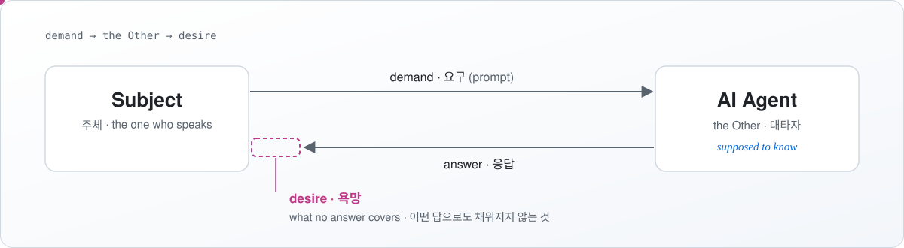

# The Other in the Machine

**People now bring their questions, demands and desires to AI agents. These notes ask what happens to the person on the other side.** 
**사람들은 이제 AI 에이전트에게 질문과 요구, 욕망까지 건넵니다. 이 노트는 그때 말하는 사람에게 무슨 일이 일어나는지 묻습니다.**

<picture>
  <source media="(prefers-color-scheme: dark)" srcset="assets/desire-dark.svg">
  
</picture>

## The argument in three lines · 세 줄 요약

1. **The agent stands in the place of the big Other**, the place questions are addressed to and where answers are *supposed* to be known.
   **에이전트는 대타자의 자리에 섭니다.** 질문이 향하고, 답을 *안다고 가정되는* 자리입니다.
2. **A prompt is a demand. What the user wants is desire**, and no answer closes the gap between the two.
   **프롬프트는 요구이고, 사용자가 원하는 것은 욕망입니다.** 어떤 답도 둘 사이의 틈을 메우지 못합니다.
3. **That gap is not a bug to remove.** Understanding it matters for anyone who builds agents.
   **이 틈은 없애야 할 버그가 아닙니다.** 에이전트를 만드는 사람이라면 이 틈을 이해해야 합니다.

## What's here · 구성

| | |
|---|---|
| [**CONCEPTS.md**](CONCEPTS.md) | Seven concepts from Lacan, each read against AI agents 라캉의 개념 일곱 개와, 각 개념을 AI 에이전트에 비추어 읽은 해석 |
| [**QUESTIONS.md**](QUESTIONS.md) | Four research questions, and what to observe for each 연구 질문 네 개와, 질문마다 관찰할 대상 |
| [**essays/**](essays/) | Longer essays, planned and in progress 계획한 글과 쓰고 있는 긴 글 |

## How these notes are written · 쓰는 방식

- **Source and reading are kept apart.** Each concept note separates what comes from Lacan's texts (*Source*) from my interpretation (*Reading*).
  **원전과 해석을 나눕니다.** 개념 노트마다 라캉의 텍스트에서 온 내용(*원전*)과 제 해석(*읽기*)을 따로 적습니다.
- **Concepts are tested against practice:** prompts, product design, logs and user behaviour.
  **개념은 현실에 비춰 시험합니다.** 프롬프트와 제품 설계, 로그, 사용자 행동을 기준으로 삼습니다.
- **No clinical claims.** These are research notes, not therapy or advice.
  **임상적 주장은 하지 않습니다.** 이 글은 연구 노트이며, 치료나 상담을 제공하지 않습니다.

Working notes: they change often, and some of them are wrong in ways I haven't found yet. 
작업 중인 노트라서 자주 바뀝니다. 아직 찾지 못한 오류도 있을 것입니다.

— [Jaeyeoul Ahn](https://github.com/jb7959)
